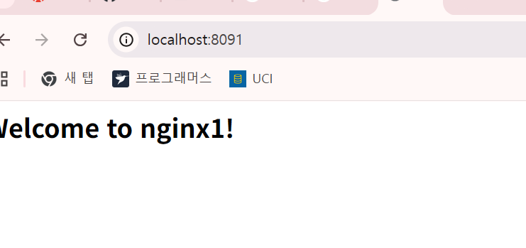
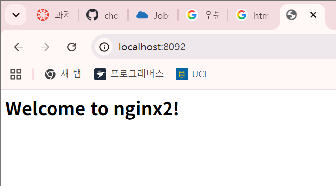
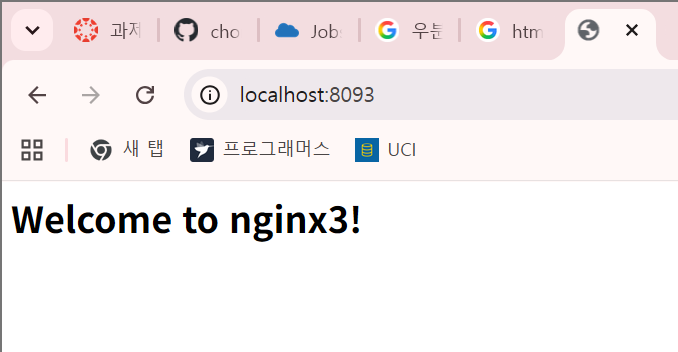
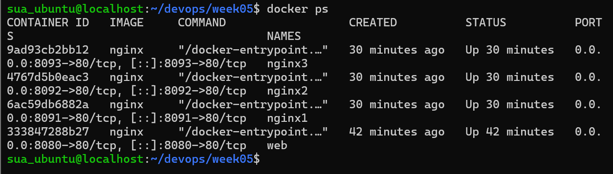

# 5주차 - 도커 w/ GitHub Issue

Docker로 nginx 컨테이너를 실행하고, 실습 과정을 Issue → Branch → PR → Merge로 관리

## 오늘 배운 내용

- 도커: 앱과 실행 환경을 컨테이너로 묶어서 "내 컴퓨터에서는 되는데요?" 문제를 줄임
- 이미지는 컨테이너를 만드는 읽기 전용 틀, 컨테이너는 이미지로 만든 실행 인스턴스. 이미지 하나로 컨테이너 여러 개 가능
- 컨테이너는 호스트 커널을 공유하고 namespace(격리)와 cgroup(자원 제한)으로 나뉨
- `-p 8080:80`: 호스트 8080 → 컨테이너 80. 컨테이너끼리는 둘 다 80이어도 충돌 없음, 호스트 포트만 달라야 함
- Issue에 목표와 완료 조건을 적고, 브랜치에서 작업한 뒤 PR 본문의 `Close #번호`로 이슈를 닫음

## 새로 배운 명령어

```bash
docker --version
docker run hello-world
docker run -d -p 8080:80 --name web nginx   # -d: 백그라운드, --name: 이름 지정
docker ps / docker ps -a                    # 실행 중 / 멈춘 것까지
docker images
docker logs -f web
docker exec -it nginx1 bash                 # 컨테이너 안으로 들어가기
docker stop web && docker rm web
docker rm -f web4
curl -I http://localhost:8091
```

## 실습 기록

결과 파일: `docker-version.txt`, `docker-info.txt`, `docker-run-hello-world.txt`, `docker-ps.txt`, `curl-result.txt`

혼자 해보기: nginx 컨테이너 3개를 8091~8093 포트로 띄우고, `exec`로 각 `index.html`을 수정

| nginx1 (8091) | nginx2 (8092) | nginx3 (8093) |
|---|---|---|
|  |  |  |

`docker ps` 결과



`curl -I`로 세 페이지 확인한 결과

```
nginx1
HTTP/1.1 200 OK
Server: nginx/1.31.6
Date: Wed, 14 Oct 2026 01:53:40 GMT
Content-Type: text/html
Content-Length: 36
Last-Modified: Wed, 14 Oct 2026 01:28:37 GMT
Connection: keep-alive
ETag: "6acedac5-24"
Accept-Ranges: bytes

nginx2
HTTP/1.1 200 OK
Server: nginx/1.31.6
Date: Wed, 14 Oct 2026 01:54:55 GMT
Content-Type: text/html
Content-Length: 36
Last-Modified: Wed, 14 Oct 2026 01:29:25 GMT
Connection: keep-alive
ETag: "6acedaf5-24"
Accept-Ranges: bytes

nginx3
HTTP/1.1 200 OK
Server: nginx/1.31.6
Date: Wed, 14 Oct 2026 01:55:08 GMT
Content-Type: text/html
Content-Length: 36
Last-Modified: Wed, 14 Oct 2026 01:29:38 GMT
Connection: keep-alive
ETag: "6acedb02-24"
Accept-Ranges: bytes
```

- 세 페이지 모두 `200 OK`. `Last-Modified`가 01:28~01:29로 서로 다른 건 `exec`로 각 `index.html`을 따로 수정했기 때문

## 트러블슈팅

- 커밋과 브랜치에 이슈 번호를 `#6`으로 붙임
  - 원인: 교안 예시의 `ISSUE_NO=6`을 그대로 사용. 실제 5주차 이슈는 `#2`
  - 결과: 이후 `#6`이 다른 PR(week02 README) 번호가 되면서 5주차 커밋 링크가 엉뚱한 곳으로 연결됨
  - 배운 점: 이슈 번호는 웹에서 확인한 값을 변수에 넣기
- Merge된 브랜치에 커밋을 더 올려서 PR을 하나 더 만듦 (PR #3 → PR #4)
  - Merge 후 같은 브랜치에 `images` 폴더를 추가 push → 새 PR이 필요했음
  - 배운 점: 완료 조건을 다 채운 뒤 PR을 만들기
