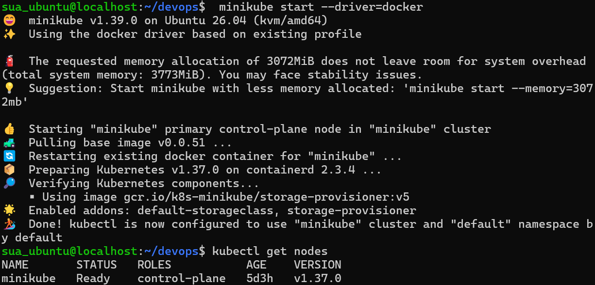
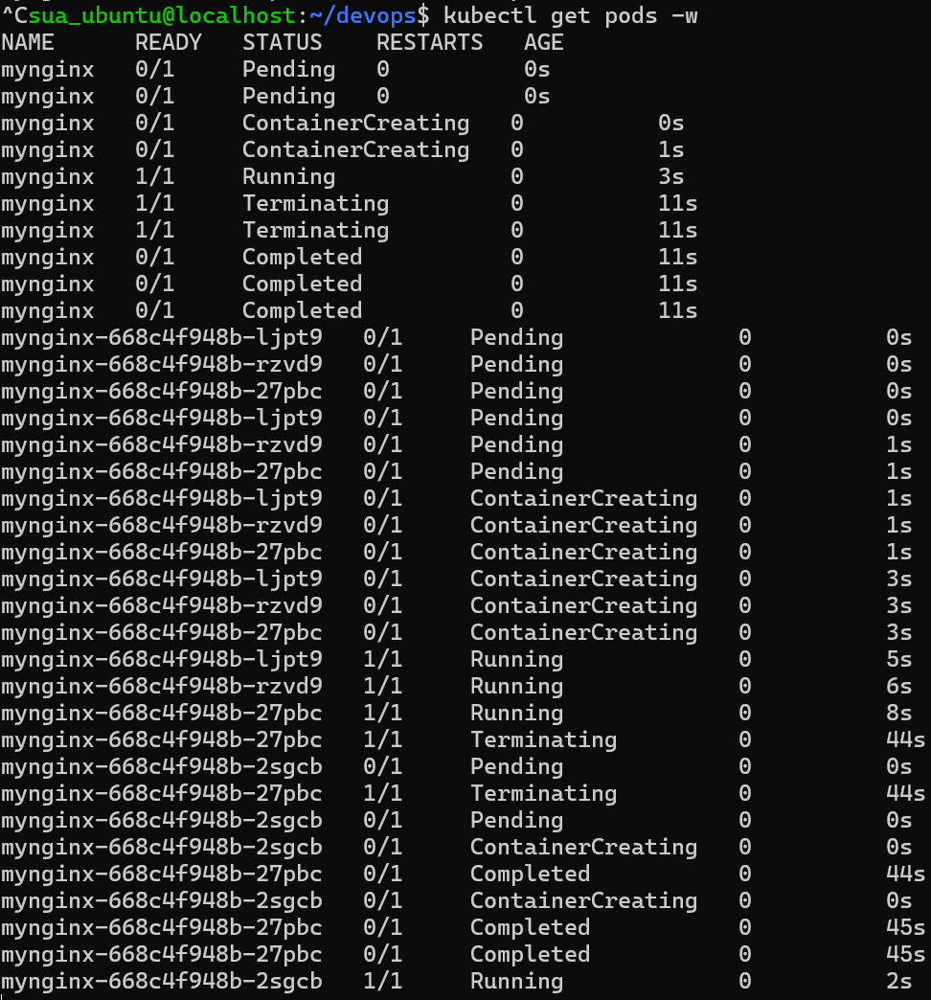
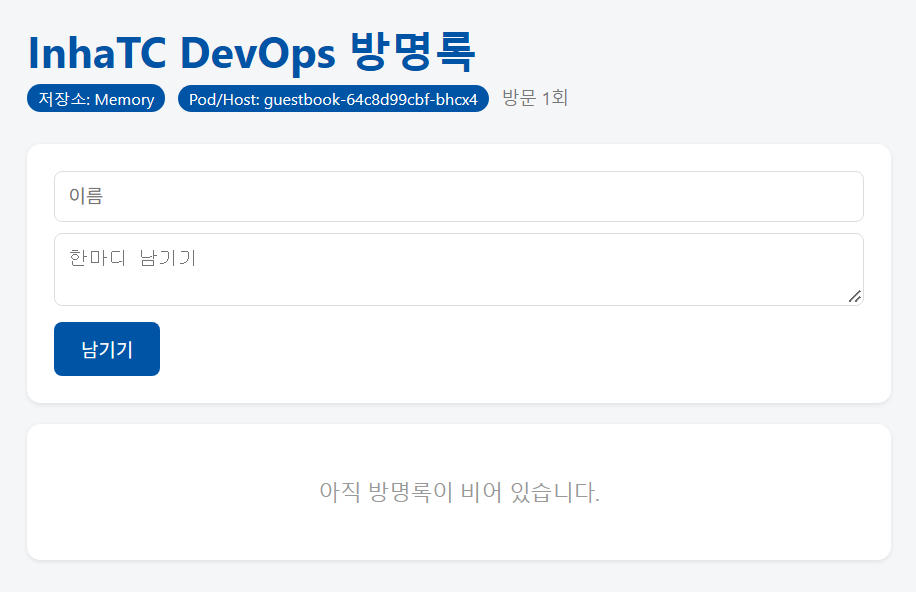

# Week09 - 쿠버네티스 첫 배포

## 1. 클러스터 준비 (`kubectl get nodes`)

- 사용한 도구: **minikube** (v1.39.0, docker driver)
- Kubernetes 버전: v1.37.0



`STATUS`가 **Ready**로 표시되어 클러스터가 정상 동작 중인 것을 확인했다.

---

## 2. Pod 자가 복구 확인 (`kubectl get pods -w`)

nginx 이미지로 replicas 3개짜리 Deployment를 만들고, Pod 하나를 지웠다.

```bash
$ kubectl create deployment mynginx --image=nginx --replicas=3
$ kubectl delete pod mynginx-668c4f948b-27pbc
```



- `27pbc`가 Terminating 되는 순간 새 Pod `2sgcb`가 Pending → ContainerCreating → Running으로 태어났다.
- Deployment가 replicas=3 상태를 유지하려고 하기 때문에, Pod를 지워도 새 Pod가 자동으로 다시 만들어진다.
- 참고: `kubectl run`으로 만든 단독 Pod(Deployment 없이)는 지우면 다시 생기지 않았다. 관리하는 주체가 없기 때문이다.

---

## 3. 방명록 쿠버네티스 배포 화면



- 저장소: Memory
- Pod/Host: `guestbook-64c8d99cbf-bhcx4`

---

## 4. 선언형이란

> 프론트데스크엔 항상 1명, 강의실엔 항상 2명이라고 원하는 상태만 정해두면 매니저가 알아서 맞춰주는 것처럼, 방법이 아니라 원하는 상태를 선언하면 시스템이 그 상태를 유지해주는 방식이다.
